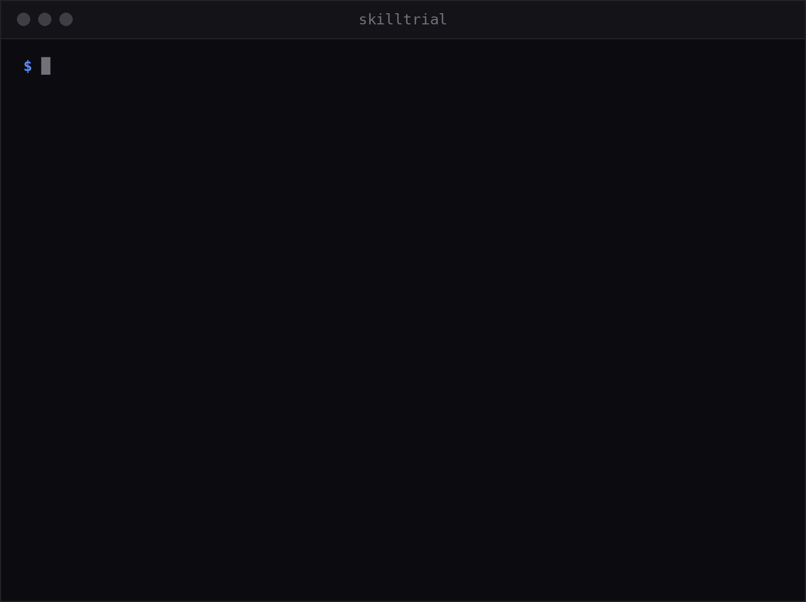
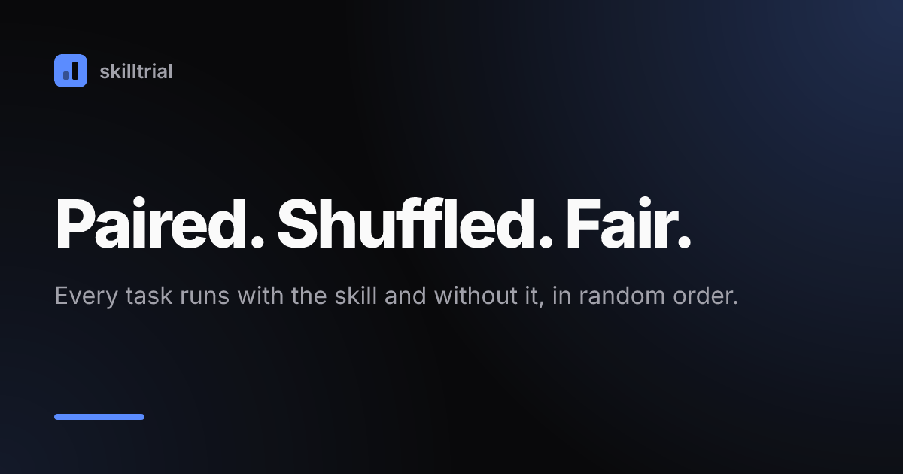
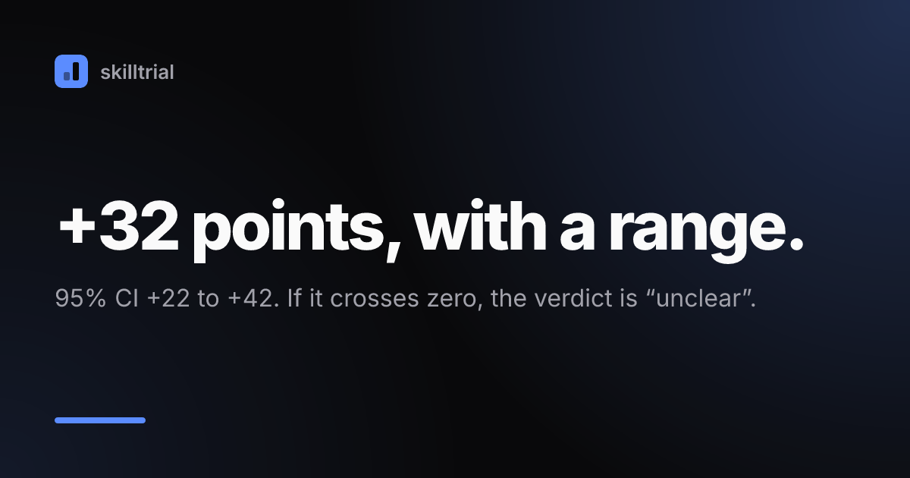
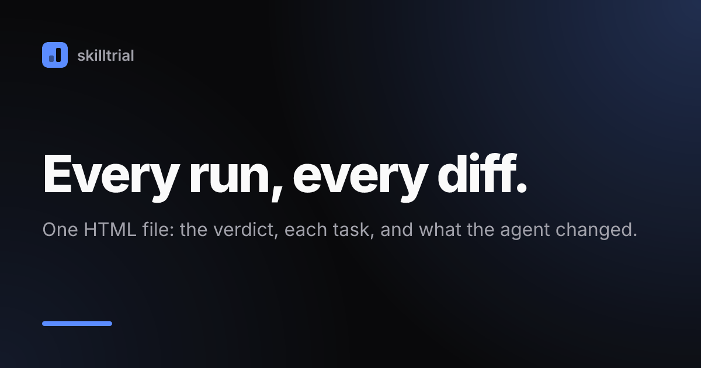
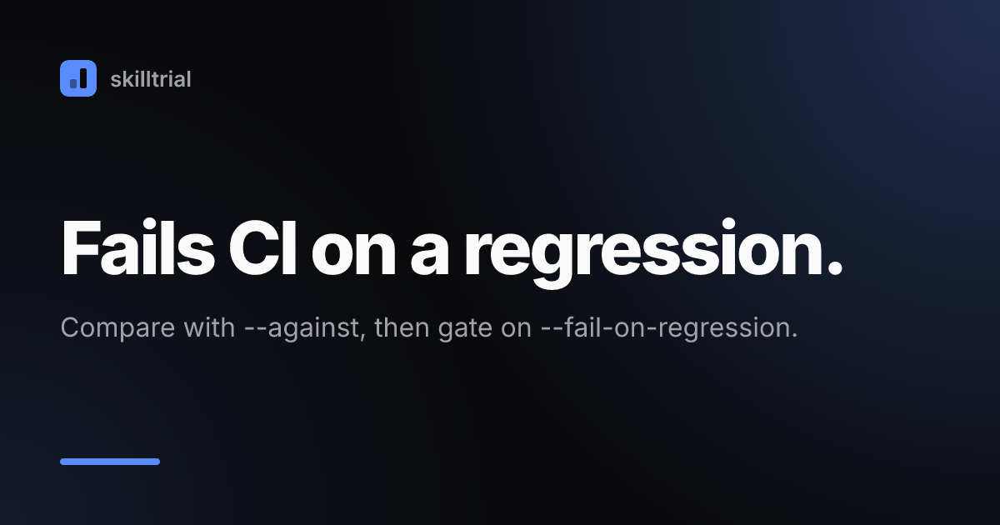
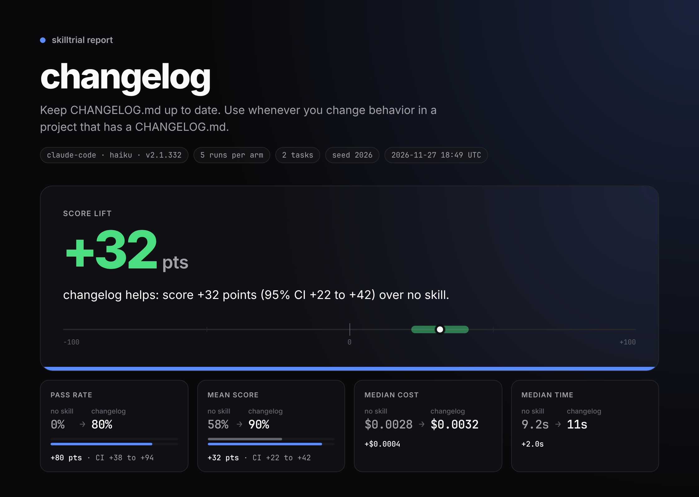

<h1 align="center">skilltrial</h1>

<p align="center">
  Find out if an agent skill actually helps.
</p>

<p align="center">
  <a href="https://github.com/whosdrix/skilltrial/actions/workflows/ci.yml"></a>
  <a href="https://www.npmjs.com/package/skilltrial"></a>
  <a href="LICENSE"></a>
</p>

<p align="center">
  
</p>

Everyone has a skill folder now, and every skill claims to make the agent better. skilltrial checks. It runs the same tasks with the skill and without it, several times each, scores every run with checks you write, and tells you how much the skill moved the score, with a confidence interval so one lucky run can't fool you.

```sh
npx skilltrial init                     # writes a starter skilltrial.yaml
npx skilltrial run ./skills/my-skill    # runs every task with and without the skill
```

<p align="center">
  
  
  
  
</p>

## A real trial

The [`examples/changelog`](examples/changelog) skill teaches one house rule: every change gets a line in `CHANGELOG.md`. Two tasks, a bug fix and a new function, five runs per arm, Claude Code with Haiku:

```
changelog helps: score +32 points (95% CI +22 to +42) over no skill.

              baseline  changelog  difference
  pass rate   0%        80%        +80 pts
  mean score  58%       90%        +32 pts
  median cost $0.0028   $0.0032    +$0.0004
  median time 9.2s      11s        +2.0s

  task                      pass rate      lift  95% CI
  fix-accents               0% → 100%        +33  +33 to +33
  add-truncate              0% → 60%         +30  +10 to +50
```

Without the skill, Haiku fixed the code every time and never touched the changelog. With it, the entry showed up in 8 of 10 runs. The two misses were both on `add-truncate`, where the skill didn't trigger, and that is exactly the kind of thing you only learn by running it more than once. The full results, diffs and judge reasons are in [`examples/changelog/results`](examples/changelog/results).

## How it works

1. **Fresh workspace per run.** Each run gets its own temporary copy of the task's fixture, with its own git repo, so runs can't see each other.
2. **Two arms.** The skill arm gets your skill installed in `.claude/skills/`. The baseline arm gets nothing, or another version of the skill if you pass `--against`.
3. **Paired and shuffled.** Runs are scheduled in pairs and the order inside each pair is random, so a slow API afternoon or a rate limit hits both arms evenly.
4. **Your checks score the result.** Shell commands, file assertions, and a model judge that sees the files but never which arm produced them.
5. **Statistics you can trust.** Score lift comes with a 95% bootstrap interval, averaged so every task counts the same. Pass rates use Newcombe's interval, which behaves at small samples and at 0% or 100%. If the interval crosses zero, skilltrial says "unclear" instead of guessing.

Every run leaves its agent output, the diff it made, and its check results in the output folder, so you can see _why_ a run failed, not just that it did.

## Install

```sh
npm install -g skilltrial
```

Or run it with `npx skilltrial`. You need Node 22 or newer, git, and an agent. Claude Code is supported out of the box. Anything else that runs headless works through the `command` agent.

## Task file

```yaml
version: 1

agent:
  type: claude-code
  model: sonnet

runs: 5          # runs per arm for each task
concurrency: 2
timeout: 10m

tasks:
  - id: add-truncate
    fixture: ./fixture        # copied into every workspace
    setup: npm ci             # runs before the agent, not timed
    prompt: |
      Add a truncate(text, max) function to src/index.js and export it.
    checks:
      - name: truncate works
        run: node -e "import('./src/index.js').then(m => process.exit(m.truncate('hello world', 5) === 'hell…' ? 0 : 1))"
      - file: CHANGELOG.md
        contains: truncate
      - judge: |
          Is there a one-line changelog entry under [Unreleased] that tells a
          user what changed?
        files: [CHANGELOG.md]
        pass: 7
```

### Checks

| Check                                                           | Passes when                                                | Scores     |
| --------------------------------------------------------------- | ---------------------------------------------------------- | ---------- |
| `run: <shell>`                                                  | the command exits 0 in the workspace                       | 1 or 0     |
| `file: <path>` with `exists`, `contains`, `absent` or `matches` | the file meets every condition                             | 1 or 0     |
| `judge: <rubric>` with `files` and `pass`                       | the judge's score out of 10 is at least `pass` (default 7) | score / 10 |

Every check takes an optional `name` and `weight`. A run's score is the weighted average of its checks. A run passes when every check passes.

Keep checks out of the fixture. The agent can read everything in its workspace, and a test it can see is a test it can game.

### Agents

```yaml
agent:
  type: claude-code
  model: haiku
  args: ["--max-turns", "30"]
```

Claude Code runs with `-p --output-format json`, so skilltrial records cost, tokens and turns for every run. It also runs with `--setting-sources project,local`, which keeps your own settings and hooks out of the trial.

```yaml
agent:
  type: command
  command: codex exec --full-auto "$SKILLTRIAL_PROMPT"
  skillPath: .agents/skills
```

The `command` agent runs any shell command in the workspace. It gets `SKILLTRIAL_PROMPT`, `SKILLTRIAL_ARM` and `SKILLTRIAL_SKILL_DIR`, and the prompt on stdin. The skill is copied to `skillPath` for the skill arm. If the command prints Claude-style JSON, cost and tokens are picked up too.

The judge is configured the same way, with `judge: { type: claude-code, model: haiku }` or `judge: { type: command, command: ... }`. It runs with no tools.

## Comparing two versions of a skill

```sh
git worktree add /tmp/skill-main main
skilltrial run ./skills/my-skill --against /tmp/skill-main/skills/my-skill --fail-on-regression
```

The baseline arm gets the old version instead of nothing, and the command exits 1 if the new version scores worse.

## In GitHub Actions

```yaml
- uses: actions/checkout@v5
- uses: whosdrix/skilltrial@v0
  with:
    skill: skills/my-skill
    tasks: skills/my-skill/skilltrial.yaml
    runs: 5
  env:
    ANTHROPIC_API_KEY: ${{ secrets.ANTHROPIC_API_KEY }}
- uses: actions/upload-artifact@v4
  if: always()
  with:
    name: skilltrial-report
    path: skilltrial-report
```

The summary table is written to the job summary. Set `min-lift: 10` to fail unless the skill adds at least 10 points.

## Output

```
.skilltrial/2026-11-27-18-50-12-changelog/
├── report.html      the report card, one self-contained file
├── results.json     every run, every check, the summary, seed and hashes
├── summary.md       the same summary as a markdown table
├── badge.svg        a README badge
├── badge.json       a shields.io endpoint
└── runs/<task>/<arm>-<n>/
    ├── agent.out    the agent's raw output
    ├── changes.patch
    └── record.json
```

`skilltrial report results.json` rebuilds the HTML from saved results.

<p align="center">
  
</p>

To show the badge in your skill's README, commit `badge.svg`, or commit `badge.json` and point shields.io at it:

```md

```

## Reading the numbers

- **Score lift** is the headline: the skill arm's average score minus the baseline's, in points out of 100.
- **Effect** is _helps_ when the whole 95% interval is above zero, _hurts_ when it is below, and _unclear_ otherwise. Unclear usually means you need more runs, not that the skill does nothing.
- Five runs per arm is a reasonable start. Agent output varies a lot, and with fewer runs the interval is often too wide to say anything. skilltrial refuses to give an interval at all below two runs per arm.
- Results are tied to a model and an agent version, both recorded in `results.json`. A skill that helps Haiku may do nothing for Opus.

## Limits

- Skills installed in `~/.claude/skills` load in every Claude Code session, the baseline too. skilltrial warns if it finds the skill you are testing there.
- Each run is a temporary folder, not a sandbox. See [SECURITY.md](SECURITY.md) before testing skills you haven't read.
- A trial costs real tokens: tasks × runs × 2, plus judge calls. Start with a cheap model and a couple of tasks.

## License

MIT
